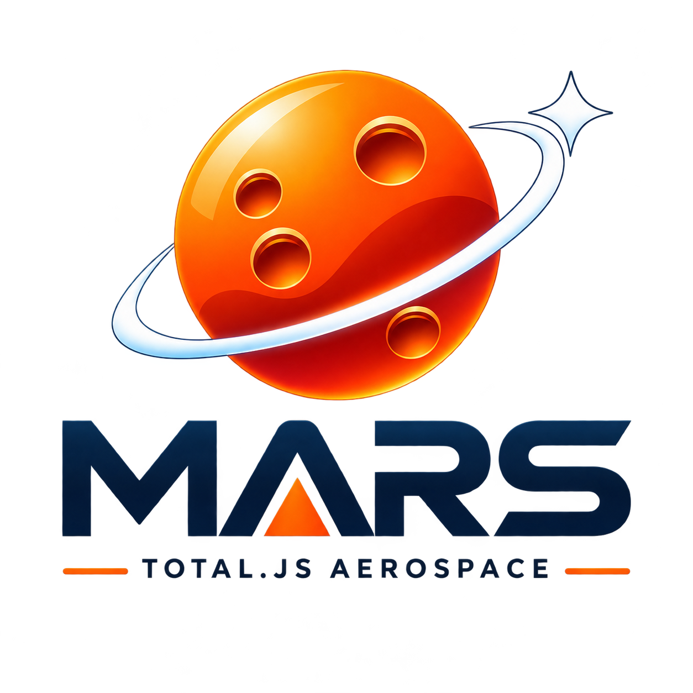

  

# MARS — Identity, Name and Project Vision

**Project name:** MARS  
**Acronym:** **Modular Architecture for Resource-constrained Systems**  
**Implementation language:** Rust  
**Owner:** Spanish Total.js  
**Licence:** Proprietary. Source code is delivered only to licensed clients  
**Status:** Product definition; technical capabilities and performance remain to be demonstrated.

## 1. Why MARS?

MARS began as an exploration of software for small satellites, where memory, compute capacity, power and reliability are hard constraints. The investigation led to a broader insight: the same design principles serve industrial controllers and automation, sensors, IoT devices, robotics, energy infrastructure and other embedded systems.

The name **MARS** keeps the project's space-inspired origin without restricting it to aerospace.

## 2. What the acronym means

- **Modular:** applications include only the components they require. Modules are independently testable and licensable.
- **Architecture:** MARS provides small, composable interfaces and building blocks rather than a large, mandatory application stack.
- **Resource-constrained:** RAM, flash, CPU time and energy are explicit design constraints, not afterthoughts.
- **Systems:** the foundation is sector-independent, from small microcontrollers to more capable embedded Linux devices.

## 3. Positioning

> **MARS is a commercial, modular Rust runtime for embedded and resource-constrained devices, born from the needs of small satellites and built for aerospace and industry.**

Short description:

> **MARS — Modular Architecture for Resource-constrained Systems. A minimal, modular Rust runtime for embedded and resource-constrained devices.**

Tagline (provisional):

> **Small core. Purpose-built modules. Measurable resources.**

These statements describe design intent; they do not assert benchmark superiority or flight qualification.

## 4. Relationship to Total.js

MARS is **not** a JavaScript runtime, a Node.js port or a renamed Total.js Framework v5. Node.js and Total.js need far more memory and processing than the target devices offer, which is why MARS is written in Rust. The `.js` suffix is intentionally absent.

MARS is a separate Rust product by **Spanish Total.js**. It takes architectural ideas from Total.js (simple composition, reusable components, straightforward input-to-output processing) without carrying over web-specific implementations. Total.js remains a natural choice for **ground tooling**: simulators, telemetry dashboards and test orchestration running on ordinary servers.

## 5. Core technical principles

1. **Input → Process → Output:** keep the basic data path simple and explicit.
2. **Rust `no_std` first:** support targets without an operating system or standard library.
3. **No mandatory heap allocation:** prefer bounded buffers, static storage and explicit ownership.
4. **Small optional modules:** no HTTP server, CMS, ORM, WebSocket or web stack in the core.
5. **Hardware independence:** keep platform-specific drivers and protocols outside the core.
6. **Explicit failures:** error handling, bounded execution and safe recovery appropriate to each deployment.
7. **Interoperability:** stable C-compatible interfaces for integration into existing C/C++ systems.
8. **Evidence over claims:** measure binary size, peak RAM, execution time, energy where feasible, and robustness under controlled workloads.
9. **Licence hygiene:** permissive third-party dependencies only; no GPL, LGPL or AGPL.
10. **No automatic space qualification:** flight readiness, radiation tolerance and sector certification require separate engineering and validation.

## 6. Product structure

### MARS Core

Sector-neutral Rust primitives for lifecycle, bounded input → process → output, error handling and optional component composition. Every abstraction must justify its resource cost.

### MARS Modules

Opt-in, separately licensed building blocks. Candidates: telemetry, health, commands, storage, transport, an embedded web interface for device configuration and diagnostics, and a module for research and experimental payloads. The exact scope of each is set by client requirements and measurements.

### MARS Space

The aerospace profile: spacecraft telemetry and command formats, bus adapters and integration with existing flight software such as cFS or F Prime. It must not force aerospace-specific dependencies into MARS Core.

### Industry profiles

Industrial automation, energy monitoring, remote sensing, IoT and robotics are target markets. Sector-specific modules are built for them on the same core; these are opportunities, not existing deployments or compliance claims.

## 7. First milestone: MARS v0.1

- Minimal Rust `no_std` core that builds for at least one clearly specified embedded target.
- A simple **input → process → output** example with bounded buffers and explicit error handling.
- One telemetry module, compiled independently.
- Unit tests and a host-side test harness.
- Documented build commands, target and toolchain versions, and memory assumptions.
- Benchmarks against equivalent minimal C and Rust implementations with identical inputs and behaviour.
- Licence check (`cargo-deny`) in the build.

**Success is not "the smallest framework in the world."** Success is a small, understandable, testable foundation with transparent resource measurements that a client engineer can evaluate.

## 8. Non-goals for the initial version

- Porting Total.js Framework v5.
- Embedding Node.js, Bun, Deno, V8 or a JavaScript interpreter.
- A web server, CMS, database abstraction or general-purpose networking framework in the core.
- Replacing mature flight-control software before evidence and validation exist.
- Claiming superiority to C, Rust, cFS, F Prime or other systems without comparable benchmarks.
- Claiming certification, radiation hardening or flight heritage.

## 9. Long-term direction

MARS should become an embedded runtime that equipment manufacturers license because its smallest configurations are easy to understand, its resource costs are reproducible, and its modules save them integration work. Aerospace is the flagship market; industrial and IoT clients provide accessible hardware, earlier sales and early validation.

## 10. Naming and branding notes

- **Canonical name:** MARS
- **Canonical expansion:** Modular Architecture for Resource-constrained Systems
- **Language:** Rust
- **Owner:** Spanish Total.js
- **Relationship:** independent product inspired by Total.js, not "Total.js Rust" or "Total.js MARS"
- **Space connection:** origin and flagship market, not the only market

---

**Decision record:** MARS (Modular Architecture for Resource-constrained Systems) is a proprietary Rust runtime for resource-constrained devices, sold as a minimal core plus separately licensed modules, with aerospace roots and cross-industry markets. Source is delivered to licensed clients only.
