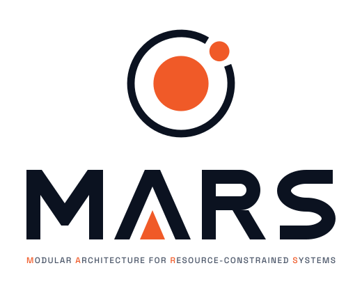

  <picture>
    <source media="(prefers-color-scheme: dark)" srcset="branding/mars-logo-dark.svg">
    
  </picture>

# MARS 🚀

**Modular Architecture for Resource-constrained Systems**  
*Small core. Purpose-built modules. Measurable resources.*

> **Status: early development.** No code has shipped yet. MARS is not flight-qualified or certified, and is not suitable for safety-critical operation without mission-specific engineering, verification and approval.

**MARS** is a commercial embedded runtime developed by **Spanish Total.js** and written in **Rust**. It gives equipment manufacturers a small, modular foundation for software that runs on constrained hardware: satellites and CubeSats, payload computers, industrial controllers and automation, sensors, energy equipment and robotics.

Clients license a minimal core plus only the modules they need. Each module is compiled in or left out, so a device carries no code it does not use.

## Why Rust

Space and industrial devices have hard limits on RAM, flash, CPU time, power and physical access. A JavaScript runtime such as Node.js, and therefore Total.js itself, needs far more memory and processing than these devices offer.

Rust compiles to native machine code like C, with no interpreter, virtual machine or garbage collector. It can run without an operating system (`no_std`), and it prevents whole classes of memory errors at compile time. **It does not automatically guarantee smaller, faster or lower-power software**; those properties must be measured for each workload.

## Principles

1. **Minimal by design**: a module ships only if a client needs it.
2. **Measured, not claimed**: every figure comes with hardware, toolchain, build settings and raw data.
3. **Reliability before features**: explicit limits, error handling, recoverability and testability.
4. **Modular by default**: optional components with small, well-defined interfaces.
5. **Security and isolation**: validate commands and inputs, and keep experiments away from critical systems.
6. **No unsupported claims**: no flight readiness, certification or compliance without evidence.
7. **Input → Process → Output**: the simple, explicit data path that Total.js is known for, rebuilt natively for embedded hardware.

## Product structure

| Layer | What it is | Status |
| --- | --- | --- |
| **MARS Core** | Sector-neutral Rust `no_std` primitives: lifecycle, bounded input → process → output, typed errors, fixed-size buffers | First milestone |
| **MARS Modules** | Opt-in, separately licensed building blocks | Candidates below |
| **MARS Space** | Aerospace profile: spacecraft telemetry and command formats, bus adapters, integration with existing flight software | Planned |
| **Platform adapters** | Hardware and OS integrations (UART, SPI, I²C, CAN, GPIO, RTOS, embedded Linux) kept outside the core | Planned |
| **Ground tooling** | Host-side simulation, test, visualization and benchmark tools; Total.js is a good fit here because it runs on ordinary servers | Planned |

### Candidate modules

Which modules are built, and in what order, depends on what clients will pay for.

| Module | Scope |
| --- | --- |
| `mars-telemetry` | Binary packet parsing, validation, encoding, buffering and forwarding |
| `mars-health` | Resource and subsystem health counters, status reporting and watchdog integration |
| `mars-commands` | Strict command parsing, authorization hooks and validation |
| `mars-storage` | Bounded persistent or transient storage and recovery |
| `mars-transport` | Transport-independent message exchange and link adaptation |
| `mars-web` | Embedded web interface for device configuration and diagnostics *(scope to be defined)* |
| `mars-research` | Module for research and experimental payloads *(scope to be defined)* |

These are **planned concepts**, not implemented or validated modules.

## Licensing

MARS is **proprietary software**. See [LICENSE](LICENSE).

- The source code is **not public**. This repository only presents the product.
- Clients receive the source code of the core and of the modules they license, under a **commercial licence**. They may use, audit and adapt it inside their own products, but not redistribute or publish it. Aerospace and safety-related clients usually need source access for audits and certification.
- Third-party dependencies must use permissive licences (MIT, Apache-2.0, BSD, ISC, Zlib). **GPL, LGPL and AGPL dependencies are not allowed**, because they would force the code to be opened. The check is automated with `cargo-deny`, and the required third-party notices ship with every delivery.

## First milestone: MARS v0.1

A working, reproducible technical baseline:

1. Minimal `no_std` core that builds for at least one clearly specified ARM Cortex-M target, plus a host target for tests.
2. A simple **input → process → output** example with bounded buffers and explicit errors.
3. `mars-telemetry` as the first module: receive simulated binary packets, validate length, checksum and ranges, decode measurements, flag out-of-range readings, buffer a bounded amount of data, and recover predictably from malformed input and buffer pressure.
4. Unit tests, golden vectors and malformed-input tests.
5. Benchmarks against equivalent minimal C and Rust implementations, using identical inputs and behaviour.

### What we measure

- Flash and binary size, static RAM, stack and peak RAM.
- CPU cycles, throughput and latency distribution, including the worst observed latency.
- Startup and restart times.
- Energy per operation, **when suitable measurement equipment is available**.
- Behaviour under malformed input, packet loss, resource exhaustion and repeated restarts.
- Long-duration stability.

Results always include hardware, toolchain, build flags and limitations. Lower RAM alone never proves better power efficiency or suitability for space.

## Exploratory targets

These are **design goals for the minimal core, not specifications or measured results**:

| Metric | Goal |
| --- | --- |
| Core RAM footprint | Well below 1 MiB |
| Minimal binary size | Below 256 KiB |
| External runtime dependencies | None for the core, where feasible |
| Heap allocation in nominal operation | None required |
| Startup | Below 100 ms on a specified reference platform |

Real limits will be set after choosing reference hardware.

## Target platforms and safety boundaries

Development starts on an accessible ARM Cortex-M development board and on ARM64 Linux for easier instrumentation. Representative CubeSat on-board computers and industrial controllers follow once client requirements are known.

Early versions target **ground systems and non-critical payload or monitoring workloads**, not attitude control, propulsion or safety-critical control. Onboard and safety-related use requires independent supervision, failure containment, mission-specific verification and review by the client's engineering team.

Relevant concerns include radiation-induced faults, storage integrity, power interruption, limited downlink, watchdog integration, update integrity, timing constraints and recoverability. Rust is not automatically flight-qualified, and no software is radiation-hardened by its language.

## Standards and reference projects

MARS studies established practice instead of inventing its own definition of readiness:

- **ECSS** software engineering standards, including ECSS-E-ST-40: https://ecss.nl/
- **IEC 61508** functional safety, for industrial clients
- **NASA core Flight System (cFS):** https://github.com/nasa/cFS
- **NASA F´ (F Prime):** https://fprime.jpl.nasa.gov/
- **ESA NanoSat MO Framework:** https://github.com/esa/nanosat-mo-framework
- **CCSDS** space data and communication standards: https://ccsds.org/

These are references, not endorsements, partnerships or claims of compliance. Integration with cFS or F´ and CCSDS support need separate feasibility studies.

## Documents

| Document | Content |
| --- | --- |
| [MARS_IDENTITY_AND_VISION.md](MARS_IDENTITY_AND_VISION.md) | Name, positioning, product structure and non-goals |
| [branding/BRAND.md](branding/BRAND.md) | Logo, colours, typography and usage rules |

Technical specifications and benchmark results are shared with prospective clients on request.

## Roadmap

- **Phase 0, requirements and hardware survey:** real constraints from prospective clients in aerospace and industry, reference boards, failure models.
- **Phase 1, minimal core:** lifecycle, bounded processing, typed errors and memory instrumentation.
- **Phase 2, telemetry module:** the first vertical slice, with tests and a host demo.
- **Phase 3, benchmarks:** reproducible measurements against C and Rust baselines on real hardware.
- **Phase 4, fault injection and endurance:** recovery, resource bounds and long-running behaviour.
- **Phase 5, first clients:** pilot integrations with aerospace companies, universities with CubeSat programmes and industrial manufacturers.

No flight demonstration or certification is promised on this roadmap.

## Relationship to Total.js

MARS is **not** a port of Total.js, a JavaScript runtime or "Total.js Rust". It is a separate Rust product that takes architectural ideas from Total.js: simple composition, reusable components and straightforward input-to-output processing. Total.js remains useful on the ground side, for simulators, telemetry dashboards and test tooling.

---

**© Spanish Total.js. All rights reserved.**  
**MARS: made on Earth, engineered for constrained environments.** 🛰️
