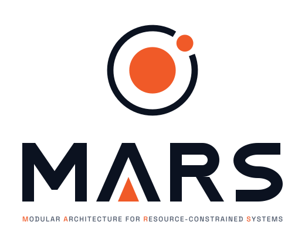

<p align="center">
  <picture>
    <source media="(prefers-color-scheme: dark)" srcset="mars-logo-dark.svg">
    
  </picture>
</p>

# MARS brand guide

## Name

- **MARS**, always in capitals. Never "Mars", "M.A.R.S." or "MARS.js".
- Full name: **Modular Architecture for Resource-constrained Systems**.
- First mention in a text: "MARS (Modular Architecture for Resource-constrained Systems)". After that, just MARS.
- MARS is presented on its own, without other product logos next to the mark. When the maker needs to be named, write "by Spanish Total.js" in plain text, outside the logo.

**Tagline:** *Small core. Purpose-built modules. Measurable resources.*

## The symbol

<p>
  
</p>

An orange **core** inside an **orbit**, with one **module** travelling along it. It tells the product in one picture: a small core, and modules added only where they are needed. The gap in the orbit around the module keeps the mark light and readable at 16 px.

## The wordmark

Custom geometric letters drawn for MARS, not typed in a font. The **A** has no crossbar: its counter is an orange triangle, a launch arrow pointing up. The wordmark belongs to MARS and does not depend on any font licence.

## Files

| File | Use |
| --- | --- |
| `mars-logo.svg` / `mars-logo-dark.svg` | Main logo, stacked, with the acronym. Light / dark backgrounds |
| `mars-logo-horizontal.svg` / `-dark.svg` | Horizontal logo for headers, slides and documents |
| `mars-mark.svg` / `mars-mark-dark.svg` | Symbol alone: avatars, small spaces |
| `mars-wordmark.svg` / `-dark.svg` | Wordmark alone, when the symbol is already present |
| `favicon.svg` | Browser favicon; follows the browser's light or dark theme |
| `favicon-32.png`, `apple-touch-icon.png`, `mars-icon-512.png`, `mars-icon.svg` | App icon on a navy tile |
| `mars-social.png` / `.svg` | Social preview, 1280 × 640 (GitHub, LinkedIn, X) |

On GitHub and the web, switch automatically between light and dark:

```html
<picture>
  <source media="(prefers-color-scheme: dark)" srcset="branding/mars-logo-dark.svg">
  
</picture>
```

## Colour

| Name | Hex | Use |
| --- | --- | --- |
| **Mars Orange** | `#F05A28` | Core, module, the A triangle, highlights. One accent per view, never large text |
| **Space Navy** | `#0B1220` | Ink on light backgrounds; dark backgrounds |
| **Orbit White** | `#F5F7FA` | Ink on dark backgrounds |
| **Deep Space** | `#1B2A4A` | Secondary dark surface, gradients on dark backgrounds |
| **Slate** | `#4A5568` | Secondary text on light backgrounds |
| **Steel** | `#8B95A7` | Secondary text on dark backgrounds |
| **Rust** | `#B5361D` | Hover or pressed state of Mars Orange; never in the logo |

Contrast (WCAG): Mars Orange on Space Navy 5.5:1, on white 3.4:1, so orange is fine for graphics and large text but not for body text on white. Slate on white is 7.5:1 and Steel on Space Navy 6.2:1. For body text use Navy, White, Slate or Steel.

## Typography

All fonts are free under the SIL Open Font License.

| Role | Typeface |
| --- | --- |
| Headings, acronym, UI labels | **Space Grotesk** (500–700) |
| Body text | **Inter** (400–600) |
| Code, data, telemetry | **JetBrains Mono** (400–500) |

The acronym under the logo is set in Space Grotesk Medium, uppercase, with wide spacing; the initials M, A, R and S are Mars Orange.

## Clear space and minimum size

- Clear space around any logo: at least the height of the orbit's module dot × 2 on every side.
- Minimum width: stacked logo 120 px, horizontal logo 160 px. Below that, use the symbol alone.
- The symbol works down to 16 px. Below 24 px, use `favicon.svg` or the app icon.
- Drop the acronym line when the logo is narrower than 240 px; it becomes unreadable.

## Do not

- Recolour the logo, add gradients, shadows, glows or outlines.
- Stretch, rotate or re-space the letters.
- Put the logo on busy photos or mid-tone backgrounds without a navy or white panel.
- Close the gap in the orbit or move the module.
- Add a crossbar to the A, or replace the wordmark with a typed font.
- Combine the logo with another product's logo or name in a single lockup.

## Provenance

Hand-drawn vector by Claude (the Recraft generator was not available) and approved on 16 November 2026, choosing the "core" symbol over a ringed-planet and a banded-planet version.

```
Subject:     MARS symbol (core + orbit + module) and custom geometric wordmark with acronym
Style:       flat geometric vector, no gradients in the mark
Palette:     #F05A28, #0B1220, #F5F7FA, #8B95A7, #4A5568
Background:  transparent (logos); navy tile (app icon, social preview)
Output:      SVG, text outlined; PNG exports for icons and social preview
Sizes:       verified at 16, 32, 64 px and full size, light and dark
```
